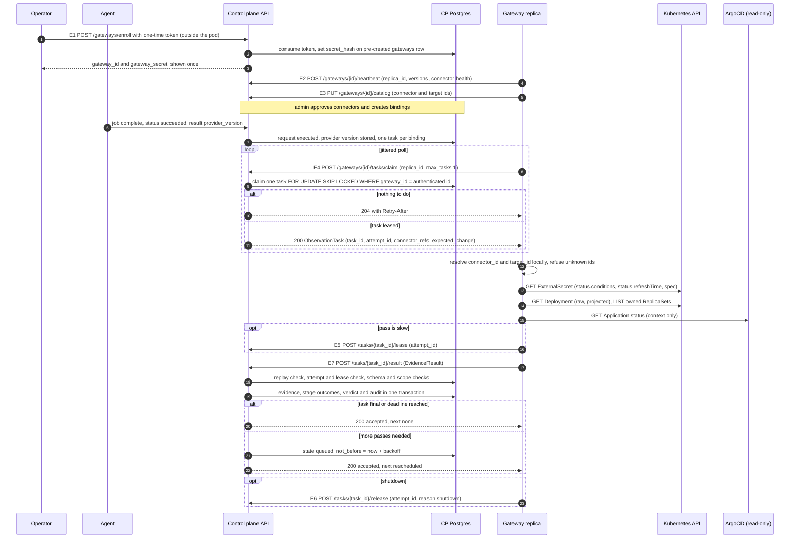

# ADR 0001: Gateway as an outbound-only observation plane

- Status: Proposed
- Date: 2026-10-18
- Scope: the Gateway component, its wire contract with the control plane, the control plane changes it needs, and its runtime and packaging. Nothing in this ADR is implemented.
- Detailed design:
  - [Control plane changes](../design/control-plane.md)
  - [Gateway runtime and packaging](../design/runtime.md)
  - [Threat model](../design/threat-model.md)
  - Schemas: [`observation-task.schema.json`](../../schemas/observation-task.schema.json), [`evidence-result.schema.json`](../../schemas/evidence-result.schema.json)

Where this ADR and a design document disagree, this ADR wins and the design document is a bug.

## 1. Context

### 1.1 What exists today

Observation of a secret change after it reaches the provider runs inside the control plane (CP):

1. When a request reaches `executed`, `GitOpsService.Start` (`api/internal/services/gitops.go`) creates one `gitops_observations` row per configured application mapping, state `queued`, with `timeout_at = now + ObservationTimeout` (default 30m).
2. The worker runs `GitOpsPoller` (`worker/internal/sweepers/gitops_poller.go`) every `SB_WORKER_GITOPS_POLL_INTERVAL` (default 15s) under the scheduler's per-sweeper Redis lock. It claims rows with `ClaimNextActive` (`api/pkg/storage/gitops_observations.go`, `FOR UPDATE SKIP LOCKED`), unwraps the stored ArgoCD token with the KMS `KeyManager`, builds the read-only client from `api/pkg/argocd`, calls `GetApplicationResourceTree` and stores a filtered snapshot in `observed_state`.
3. `decideTerminalState` sets `applied` when `.status.health.status == Healthy`, `.status.sync.status == Synced` and `.status.operationState.phase` is empty or `Succeeded`, and `failed` when the phase is `Failed` or `Error`.
4. `GitOpsTimeoutSweeper` (`worker/internal/sweepers/gitops_timeout.go`) moves rows past `timeout_at` to `applied_unverified`.

### 1.2 Problems

| # | Problem | Where it shows |
|---|---|---|
| P1 | The CP needs network reachability to ArgoCD endpoints that usually sit on private customer networks. Each new cluster is a new inbound path into that network. | `argocd_endpoints.base_url`, `GitOpsPoller` |
| P2 | The CP holds a long-lived credential for a customer-internal system, KMS-wrapped but decrypted in worker memory on every poll. | `unwrapToken`, `BuildTokenResolver` |
| P3 | ArgoCD is the only evidence source and `applied` comes from ArgoCD status alone. A Secret change does not change Git, so an app can be `Healthy`/`Synced` with pods that never picked up the new value. | `decideTerminalState` |
| P4 | Nothing links an observation to a specific change. The row knows the request and the app, not which provider version was written. | `GitOpsObservation`, `GitOpsService.Start` |
| P5 | No per-claim lease or owner. `ClaimNextActive` ignores `claimedBy`. Acceptable for one in-CP sweeper, not for remote pollers on an untrusted network. | `gitops_observations.go` |
| P6 | External Secrets Operator (ESO) and Deployment rollout state are not observed, and could not be from the CP without Kubernetes API access to every customer cluster. | n/a |

Three further findings shape the decision:

- **The agent does not report the provider version it wrote.** `PatchExecutor` discards the `providers.SecretVersion` returned by `PutValue` (`agent/internal/executor/patch.go`). `JobOutcome` (`agent/internal/client/jobs.go`) and `CompleteRequest` (`api/internal/handlers/jobs.go`) carry only `status` and `error`. The providers do produce a version: AWS returns `VersionId` (`core/providers/awssecretsmanager/awssecretsmanager.go`), and Vault KV v2 returns `data.version` and `data.created_time` (`versionFromWrite` in `core/providers/vault/vault.go`).
- **Patch requests may never start an observation today.** `GitOpsService.Start` returns early when `request.SecretMappingID == nil`, and no code under `api/internal/services/requests*.go` sets it for patch requests. Verify with a live patch request before using the poller as a parity baseline.
- **`SyncJobs.ClaimNext` has no scope predicate and `SyncJobs.Complete` fences on `claimed_by` only** (`api/pkg/storage/jobs.go`). Copying them as they are would allow cross-tenant delivery and would let a stale result from one replica land on another replica's claim, because all replicas of a Gateway share one identity.

### 1.3 Forces

- The Agent already has an outbound-only claim, lease and complete pattern over HTTPS.
- Customer security teams accept outbound HTTPS from a cluster. They do not accept new inbound paths or exported credentials.
- Observation must never block or weaken secret execution.
- No secret values and no hashes of values may leave the customer boundary for this purpose.

## 2. Decision

Introduce **Gateway**, a separate, optional, stateless Go service (this repository) that runs inside the customer security boundary. It:

1. authenticates to the CP with a Gateway identity modelled on agent enrollment, in separate tables and middleware;
2. claims request-scoped observation tasks over outbound HTTPS from a Postgres queue (`FOR UPDATE SKIP LOCKED`, the `sync_jobs` pattern plus a scope predicate and per-claim fencing);
3. reads only targets that the customer defined locally and an admin bound in the CP: ESO `ExternalSecret` status, Deployment and ReplicaSet rollout metadata, and ArgoCD Application status as context;
4. posts metadata-only evidence, which the CP validates, stores append-only, and turns into per-stage outcomes and one honest verdict per task.

The CP never opens a connection to a customer integration on the Gateway path. The existing worker poller stays as it is until an environment is switched to the Gateway (section 9).

The rest of this section fixes the rules that every design document references.

### 2.1 Vocabulary

| Concept | Value |
|---|---|
| Connector kinds | `eso`, `rollout`, `argocd` |
| Stages | `secret_updated` (CP fact from the agent report), `eso_sync`, `workload_rollout`, `argocd_context` |
| Stage outcome | `observed`, `not_observed`, `not_applicable`, `unverifiable`, `failed`, `error` |
| Linkage (per stage) | `version_pinned`, `time_ordered`, `none` |
| Task delivery state | `queued`, `leased`, `done`, `dead`, `cancelled` |
| Task verdict | `pending`, `verified`, `partially_observed`, `unverified`, `timed_out` |
| Change marker | `provider_version_id`, `provider_version_at` (agent or provider clock), `executed_at` (CP clock) |
| Replica id | `replica_id` body field, random UUIDv4 generated at process start |

Display strings such as "partially observed" or "timed out, unverified" belong to the UI only. Wire values and database values use the snake_case forms above.

Stage outcomes `observed`, `not_applicable`, `unverifiable` and `failed` are terminal for that stage. `not_observed` and `error` are not; the CP schedules another pass.

### 2.2 Linking evidence to the change

**Prerequisite (additive agent and api change):** `JobOutcome` gains an optional `result.provider_version {id, created_at}` taken from the `SecretVersion` that `PutValue` already returns. The api stores it in a new nullable `sync_jobs.result JSONB`. An empty `id` (Vault KV v1 writes return no version) is stored as null with `version_source: "none"`. For AWS Secrets Manager `created_at` is the agent's `time.Now().UTC()` at write time, not a provider timestamp; for Vault it is the server `created_time` when present. Agents that do not send `result` keep working, and their tasks cannot be `verified`.

The chain the CP evaluates for one task:

1. **Write.** The job succeeded and the CP recorded `provider_version_id` V and `executed_at` T (CP clock).
2. **Sync.** The ExternalSecret is `Ready=True` and `.status.refreshTime` is strictly greater than T plus skew, rounded up to the next whole second (`metav1.Time` has second precision, so equal timestamps never count). The ExternalSecret references the bound provider key and is not pinned to another version. ESO fetches the current version on each refresh, so a refresh after T fetched V or something newer. This is a time-ordered link, not an identity link, because ESO status does not report which provider version it read (verify for the supported ESO range). If the ExternalSecret pins `remoteRef.version` to V, the link is `version_pinned`.
3. **Rollout.** A ReplicaSet owned by the bound Deployment was created after that `refreshTime` (or the revision annotation increased after the baseline pass, see runtime 3.4), and the rollout is complete by the `kubectl rollout status` rules: `observedGeneration >= generation`, `updatedReplicas == spec.replicas`, `status.replicas == updatedReplicas`, `availableReplicas == updatedReplicas`.
4. **Context.** ArgoCD sync and health for the bound Application. Never part of the chain.

Skew is `margin + |cp_offset_ms| + |apiserver_offset_ms|`. The Gateway measures both offsets from the `Date` headers of the CP and Kubernetes API responses and reports them in every result (`clock`). The default margin is 5s and must cover provider read-after-write lag (AWS Secrets Manager and Vault performance standbys can serve the previous version briefly after a write; verify per provider).

**Cannot prove:**

- That ESO fetched exactly V. A write made outside Secrets Bridge between T and the refresh is invisible. The CP rules out later writes made through Secrets Bridge.
- That ESO did not serve a cached provider client or value (verify per ESO provider).
- That the new pods read the new value, or that a rollout was caused by the secret change rather than a coincident deploy. A Reloader annotation narrows this; it does not prove it.
- That a process uses the new value. The design proves ordering of observable events, not process memory.

**Never used:** Kubernetes `Secret` objects with any verb; ESO's `reconcile.external-secrets.io/data-hash` annotation (verify the name; it is on the Secret and is a hash of values); Reloader hash values in env or annotations; `secrets.checksum` (`api/pkg/storage/migrations/0010_secrets_discovery.up.sql`) and the provider `Checksum` field (`core/providers/provider.go`, documented as a fingerprint of the value); any value or hash of a value. A CP test asserts that no Gateway task or evidence query selects `secrets.checksum`.

### 2.3 Stage rules

The CP applies these rules to the reported `facts` and stores its own outcome next to the Gateway's proposal. A disagreement is kept and audited (`gateway.evidence.outcome_mismatch`).

`eso_sync`

| Outcome | Rule |
|---|---|
| `error` | The connector could not read the ExternalSecret. Non-terminal. |
| `failed` | `Ready=False` with `lastTransitionTime` after T plus skew. |
| `unverifiable` | `remote_ref_match` is `mismatch` or `extract_or_find` with no way to tie the key; more than one ExternalSecret claims the target; pinned to another version; or not yet observed and the next timer refresh cannot happen before `deadline_at` (`refreshInterval` is 0, or `refreshTime + refreshInterval > deadline_at`), caveat `refresh_interval_exceeds_deadline`. |
| `not_observed` | Ready is not `True`, or `refreshTime` is not after T plus skew. Non-terminal. |
| `observed` | Ready `True` with reason `SecretSynced`, `refreshTime` after T plus skew, `remote_ref_match = match`. Linkage `version_pinned` if `remote_version_pin = matches_expected`, else `time_ordered` with caveat `temporal_inference_only`. |

`workload_rollout`

| Outcome | Rule |
|---|---|
| `error` | The connector could not read the Deployment or its ReplicaSets. Non-terminal. |
| `failed` | Progressing reason `ProgressDeadlineExceeded` on a rollout that started after the ESO `refreshTime`. |
| `not_applicable` | Consumption mode is `volume` with no restart trigger. The kubelet refreshes mounted Secret files without a rollout, and nothing in Deployment or ReplicaSet status shows that. Caveat `volume_refresh_not_observable`. |
| `unverifiable` | Consumption mode `env` with `reload_mechanism = none_detected` and no qualifying rollout yet: pods will not pick up the change until something restarts them (caveat `reload_mechanism_unknown`). `subPath` mounts never refresh until restart (caveat `subpath_mount_not_refreshed`). `spec.replicas == 0` (`zero_replicas`) or `spec.paused == true` (`rollout_paused`). |
| `not_observed` | No qualifying rollout yet, or the rollout is not complete. Non-terminal. |
| `observed` | Section 2.2 step 3 holds. Linkage `time_ordered`. |

`argocd_context`: at most `observed`, confidence `low`, caveat `argocd_health_not_proof` always present, linkage `none`. It never changes a verdict. ArgoCD `Degraded` is context, not a failure of the secret change.

### 2.4 Task verdict

The CP computes the verdict. The Gateway never sends one; the schema has no field for it.

A task is **final** when every expected stage has a terminal outcome. Expected stages come from the binding (`expected_stages`), so a target with no Deployment declares `workload_rollout` absent and it is not waited for.

| Verdict | Rule |
|---|---|
| `pending` | Not final, deadline not reached. Also the state while no Gateway is online. |
| `verified` | All of: `version_source = agent_reported`; `eso_sync` `observed` with linkage `version_pinned` or `time_ordered`; the CP knows no later write to the same secret reference; `workload_rollout` `observed`, or absent from the binding's expected stages; no stage `failed`; no capping caveat (`volume_refresh_not_observable`, `subpath_mount_not_refreshed`) and no CP-side reason `gateway_over_privileged`. UI label: "verified by time order, observed by Gateway X" or "verified by pinned version, observed by Gateway X". |
| `partially_observed` | Final, `verified` not met, and at least one of `eso_sync` or `workload_rollout` is `observed` (or `not_applicable` with a capping caveat). Reasons include `no_provider_version`, `volume_refresh_not_observable`, `reload_mechanism_unknown`. |
| `unverified` | Final with no Gateway stage observed; or any stage `failed` (reason `failure_observed`, and the UI shows the failed stage in the failure colour); or the task was cancelled (`superseded_by_later_write`, `source_changed`, `connector_missing`) or went `dead` (`gateway_errors`). |
| `timed_out` | `deadline_at` passed before the task was final. The UI shows what was observed, for example "timed out after ESO sync observed; rollout not observed". Never shown as a failed deployment. |

There is no `failed` verdict. A stage can be `failed`; the verdict is then `unverified` with reason `failure_observed`. Whether a `failed` verdict should exist is open question 3.

**Request rollup.** A request can have several tasks (one per binding, for example two clusters). The request state is `pending` while any task is `pending`; then `verified` only if every task is `verified`; `partially_observed` if any task is `verified` or `partially_observed`; `timed_out` only if every task is `timed_out`; otherwise `unverified`. A request with no binding shows "no observation configured", which is not a failure.

**Later write.** When a new task is created for the same secret reference while an older task is open, the CP closes the older one: `state = cancelled`, verdict `unverified`, reason `superseded_by_later_write`, with an audit event.

### 2.5 Fixed values

| Setting | Value |
|---|---|
| Lease | 60s, capped at `deadline_at`, renewable through E5 |
| In-flight tasks per replica | 1 (configurable) |
| In-flight tasks per Gateway | `gateways.max_inflight_tasks`, default 20 |
| Result body cap | 64 KiB |
| Default skew margin | 5s |
| Default deadline | `min(24h, max(binding.observation_timeout_s, refresh_interval + progress_deadline + 5m))`, where the two intervals come from the catalog for the bound targets. Default `observation_timeout_s` is 1800 (open question 4). |

## 3. Architecture

### 3.1 The three planes

| Plane | Component | Owns | Never does |
|---|---|---|---|
| Brain | Control plane (`api`, `worker`, Postgres; Redis only for existing locks, rate limits and the auth cache) | Policy, approval, Gateway registry, catalog approval and bindings, observation tasks, evidence acceptance, stage outcomes, verdicts, audit | Connect to customer ArgoCD, ESO or Kubernetes on the Gateway path. Hold customer integration credentials for environments observed by a Gateway. |
| Execution | Agent | Provider writes and reads, claims `sync_jobs`, reports the outcome and the provider version | Call or depend on the Gateway. Observe rollouts. |
| Observation | Gateway | Claims tasks, reads locally defined and CP-bound targets, posts evidence | Write anything anywhere (no sync, rollback, patch, delete, ESO force-sync annotation). Read Kubernetes `secrets`. Keep state on disk or in a database. Call the Agent. Accept URLs, namespaces, credentials or commands from a task. |

Agent and Gateway each open their own outbound HTTPS sessions to the CP. There is no path between them in either direction. An environment with no Gateway keeps full governance and execution, and its requests show "no observation configured".

### 3.2 Trust boundaries

- **CP**: trusts its own database and audit. Every Gateway submission is customer-side attestation, recorded and shown as "observed by Gateway `<name>`", never as a CP-verified fact.
- **Customer boundary**: holds the Gateway, its CP credential (a Kubernetes Secret mounted as a file, read from the filesystem, never through the Kubernetes API), the in-cluster ServiceAccount token and the ArgoCD read-only token (mounted file).
- **Gateway to integration**: read-only and least privilege. Kubernetes RBAC is `get` on `externalsecrets.external-secrets.io`, `get` on `deployments.apps` and `list` on `replicasets.apps`, per bound namespace, and nothing on `secrets`. The only non-GET Kubernetes calls are creating `SelfSubjectRulesReview` and `SelfSubjectAccessReview` objects for the boot self-check; these persist nothing and need no extra RBAC. ArgoCD calls are limited to `GET /api/v1/applications/{name}` and `GET /api/v1/session/userinfo` by a path allowlist in a GET-only transport.

Kubernetes has no server-side field selection on GET, so the full Deployment (including `env[].value` literals) reaches the Gateway process. The Gateway therefore reads Deployment and Application responses as raw bytes (`RESTClient().Get().Do().Raw()` and a bounded ArgoCD body) and decodes them only into projected structs that hold `envFrom[].secretRef.name`, `env[].valueFrom.secretKeyRef.name`, `volumes[].secret.secretName`, `volumeMounts[].subPath` presence and allowlisted annotation keys, and never `env[].value` or `spec.source.helm.values`. Typed `appsv1.Deployment` objects are not used.

### 3.3 Sequence

## 4. Contracts

Full details: [control-plane.md, section 4](../design/control-plane.md#4-wire-contract) and the two schemas.

| # | Method and path | Purpose |
|---|---|---|
| E1 | `POST /api/v1/gateways/enroll` | Exchange a one-time token for the persistent secret. Called by the operator outside the pod. |
| E2 | `POST /api/v1/gateways/{id}/heartbeat` | Liveness, `gateway_version`, `contract_versions`, connector health enum, in-flight count |
| E3 | `PUT /api/v1/gateways/{id}/catalog` | Advertise locally defined connectors and targets. Full replace. Never creates a binding. |
| E4 | `POST /api/v1/gateways/{id}/tasks/claim` | Lease at most one task. 200 with one ObservationTask, or 204. |
| E5 | `POST /api/v1/gateways/{id}/tasks/{task_id}/lease` | Renew the lease of the current attempt |
| E6 | `POST /api/v1/gateways/{id}/tasks/{task_id}/release` | Give a task back early |
| E7 | `POST /api/v1/gateways/{id}/tasks/{task_id}/result` | Submit an EvidenceResult |

Rules:

- **Auth**: `X-Gateway-Secret` on E2 to E7, SHA-256 at rest, constant-time compare, generic 401. A task that belongs to another Gateway returns 404, the same as an unknown task.
- **Targets**: the customer defines connectors and targets in Helm values. The Gateway advertises ids (and, pending open question 2, namespace and name for display) through E3. An admin approves and binds them. A task carries only `{connector_id, target_id, stage}` triples. No namespace, object name, URL or credential field exists in the task schema, and every object in both schemas is closed.
- **Fencing**: every claim mints a new `attempt_id`. A result is accepted only for the current attempt while `lease_expires_at` is in the future. A late result for the current attempt after lease expiry gets 409 `lease_expired`, even if nobody re-claimed. A result for an older attempt gets 409 `attempt_superseded`.
- **Idempotency**: key `(task_id, attempt_id)`. The CP stores a SHA-256 digest of the canonical JSON (RFC 8785) of the accepted body. The replay lookup runs before the current-attempt check, so a retry after a lost 200 gets 200 `duplicate`, and a different body under the same attempt gets 409 `result_conflict`.
- **No free text**: no field in either direction carries condition messages, error strings or caveat sentences. Caveats, reasons and error codes are enums. `gateways.last_status` is an enum and `last_error` is written by the CP only.
- **Versioning**: path `/api/v1`; payload `schema_version` constants `gateway.observation-task/v1` and `gateway.evidence-result/v1`. The Gateway sends `contract_versions` on heartbeat. A new optional field is a new version.

## 5. Control plane changes

Full details: [control-plane.md](../design/control-plane.md).

- Migrations (numbers shift if other PRs land first): Gateway registry (`gateways`, `gateway_enrollment_tokens`, `gateway_replicas`, `gateway_connectors`, `gateway_connector_bindings`), observation queue (`observation_tasks`, `observation_task_attempts`, append-only `observation_evidence`), `sync_jobs.result JSONB`, `environments.observation_source`, permission seed.
- Identity reuses the agent enrollment model in separate tables: the admin pre-creates the `gateways` row; enrollment consumes the token and sets `secret_hash` on that row in one transaction (`WHERE secret_hash IS NULL`), the `ConsumeAndCreateAgent` pattern. Separate `GatewayAuth` middleware and `/api/v1/gateways/` route group, so an agent credential can never claim observation tasks and a Gateway credential can never reach `/agents/:id/jobs` or wraps.
- Scope is expressed in CP terms. There is no tenant entity in the schema. A Gateway has a `boundary` label and an optional `environment_id`; bindings are per `environment_id`, and when `gateways.environment_id` is set the binding's environment must equal it.
- Claim query filters on `gateway_id = <authenticated id>` and uses the partial index `observation_tasks_claim_idx (gateway_id, not_before, created_at) WHERE state IN ('queued','leased')`. Expired leases re-enter inline.
- `failure_count` counts only Gateway-reported `error` stages. Releases and lease expiries do not count, so rolling restarts cannot kill a healthy task. `max_failures` (default 5) moves a task to `dead`.
- Revoking a Gateway moves its `leased` tasks back to `queued` in the same transaction.
- Rate limits run after `GatewayAuth`, keyed on the authenticated Gateway id, on heartbeat, claim, lease, release and result, with an in-process fallback when Redis is unavailable (the existing limiter fails open).
- New permissions `gateway.mint`, `gateway.revoke`, `gateway.list`, `gateway.bind`. `gateway.bind` does not imply `integration.bind` and the reverse.

## 6. Runtime and packaging

Full details: [runtime.md](../design/runtime.md).

- Go, stdlib `net/http`, `log/slog`, Prometheus client, `k8s.io/client-go`. No import of `api/pkg/*` (it pulls database and Redis drivers) or of the agent. CI guards: no database or Redis driver, no agent or api module, no `secrets` in rendered RBAC, no write verbs outside an allow file.
- Enrollment happens outside the pod (`gateway enroll` CLI subcommand or curl). The pod reads `gateway_id` and `gateway_secret` from a read-only mounted Secret and never writes a credential. No PVC.
- Connectors take one snapshot per pass. No informers, no watches, no state between passes. The CP schedules repeated passes.
- ESO API version is discovered at boot from `/apis/external-secrets.io`, preferring `v1`. If neither `v1` nor `v1beta1` is served, the connector reports `api_version_not_served`.
- Health and metrics on `127.0.0.1` only. Probes are `exec` on `gateway healthcheck`. Exposing metrics on the pod IP is opt-in with a NetworkPolicy peer list.
- Helm chart `secrets-bridge-gateway` in `secrets-bridge/charts`: namespaced Roles by default, ClusterRole only with an explicit acknowledgement, no free-form RBAC field, NetworkPolicy egress limited to DNS, the CP, the API server and listed ArgoCD endpoints, image pinned by digest.
- Boot self-check: `SelfSubjectAccessReview` for `get`, `list` and `watch` on core `secrets` in each allowed namespace, plus `SelfSubjectRulesReview`. Readiness fails closed if any `secrets` verb is allowed, or the rules review is `incomplete` with no SSAR answer. ArgoCD: `GET /api/v1/session/userinfo`, and optionally a negative probe through `GET /api/v1/account/can-i/applications/sync/<project>/<app>` (verify on supported ArgoCD versions); a `yes` for a write action on a bound app fails readiness.

## 7. Security

Full details: [threat-model.md](../design/threat-model.md).

- The main harm is a false `verified`. Mitigations: CP-computed verdicts, closed schemas, CP recomputation of stage outcomes, timestamp bounds, the "observed by Gateway X" label, and per-environment policy that can refuse Gateway attestation as evidence for a gate owned by another party.
- A compromised CP can only choose among objects the customer listed locally. It cannot point the Gateway at a new host, namespace or object.
- A compromised Gateway pod has no RBAC on `secrets`, no route to the Agent (NetworkPolicy and no client code), and no credential that works on agent routes.
- Accepted residual risks: a tenant admin can fabricate evidence for its own requests; bearer secret replay through a TLS-terminating proxy (same as the Agent today); ESO linkage is time-ordered unless pinned; a CP database administrator can fabricate rows.

## 8. Failure behaviour

| Failure | What happens | What the user sees | What does not happen |
|---|---|---|---|
| Gateway offline or not deployed | Tasks stay `queued`. Gateway marked `stale` after missed heartbeats. At `deadline_at` the task becomes `timed_out`. | "Gateway X has not checked in since T. Observation is waiting; this does not mean the deployment failed." then "timed out" | Request is not failed. Execution and approvals are unaffected. |
| CP unreachable from the Gateway | Gateway backs off. No spool to disk. Leases expire and tasks are re-claimed later. Readiness goes false after `cp.unreachableReadinessAfter`. | Stages stay `not_observed` until the CP is back, then progress or time out. | No offline durable capture. |
| CP Postgres unavailable | Claim and result fail with 5xx. Gateway backs off. | As above | No partial acceptance: evidence, outcome, verdict and audit are one transaction. |
| ESO CRD or API version missing | `eso_sync` `error` with `api_version_not_served` or `resource_not_found` | "ESO sync not observed: ExternalSecret not found" | No force-sync annotation. |
| ESO `Ready=False` after the write | `eso_sync` `failed`, reason recorded as a CamelCase token, never the message | "ESO sync failed (SecretSyncedError)" and verdict `unverified` with `failure_observed` | No message text leaves the cluster. |
| ESO will not refresh before the deadline | `eso_sync` `unverifiable`, caveat `refresh_interval_exceeds_deadline`, on the first pass | "ESO refresh interval is longer than the observation window" | No passes wasted until the deadline. |
| ArgoCD unavailable | `argocd_context` `error`. Other stages unaffected. | Context missing | An ArgoCD outage never downgrades a verdict. |
| Kubernetes API 403 | Stage `error` with `connector_forbidden` | Admin warning on the Gateway page | The Gateway does not ask for wider RBAC. |
| Env consumer with no reload mechanism | `workload_rollout` `unverifiable`, `reload_mechanism_unknown` | "Pods will not pick up the change until restarted" | No "timed out" for a rollout that cannot happen by itself. |
| Replica dies mid-task | Lease expires, another replica claims with a new `attempt_id`. Not counted as a failure. | A short delay | A late result from the dead attempt is rejected. |
| Rolling restart | Each replica releases its task (E6) before exit | Nothing | Releases do not count toward `failure_count`. |
| Task names an unknown connector or target | Gateway refuses (`attempt_status: refused`) before any read. CP audits. | Admin warning | The Gateway never reads an object that is not in its local configuration. |
| Later write to the same secret | Older open task `cancelled`, `superseded_by_later_write` | The newer request carries the observation | No double counting. |
| Gateway revoked | Next call gets 401. Leased tasks go back to `queued`. Readiness false, pod stays up with the reason in logs. | Gateway shown as revoked | No further evidence accepted. |
| Clock skew | Ordering uses `executed_at`, the measured offsets and the margin | Borderline cases stay `not_observed` until a later refresh | No ordering claim inside the skew window. |

## 9. Migration

Goal: per environment, exactly one observation source for a request, with a way back.

1. **Source switch**: `environments.observation_source` with values `control_plane` (default, today's poller), `gateway` and `none`. `SB_GITOPS_ENABLED` and `SB_WORKER_GITOPS_ENABLED` keep gating the poller globally; `SB_GATEWAY_ENABLED` gates the Gateway path.
2. **Single decision point**: in `RequestService.OnJobCompleted`, both starters read the same column once per request. `GitOpsService.Start` runs only for `control_plane`; `GatewayObservationService.Start` only for `gateway`. A request never gets both.
3. **Drain**: switching an environment to `gateway` affects requests executed after the change. Open `gitops_observations` rows finish or time out on the poller.
4. **Shadow mode** (post-MVP): both run for parity testing, the Gateway result stored and not shown, never counted.
5. **History**: existing `applied` rows are shown as "ArgoCD healthy and synced (context only, not linked to the change)", `applied_unverified` as "timed out, unverified", `failed` unchanged. No stored rows are rewritten.
6. **Rollback**: set the column back to `control_plane`. Open Gateway tasks for that environment are cancelled with reason `source_changed`; the requests show "unverified, observation source changed". Poller rows are not recreated, so nothing is counted twice.
7. **Removal**: once every environment that uses GitOps observation has moved and the owner approves, remove the poller and the stored ArgoCD tokens.

## 10. Alternatives considered

| Alternative | Why rejected |
|---|---|
| Keep CP-side polling and extend it to ESO and Kubernetes | Makes P1 and P2 worse: the CP would need reachability to and credentials for every customer Kubernetes API. Kept only as the existing path during migration. |
| Agent plugin | Couples execution and observation in one identity and one RBAC set, grows Agent permissions into Kubernetes reads, and the Agent often runs where the provider is rather than where the workload is. Breaks "no Agent dependency". |
| Redis Streams with consumer groups (proposed in the epic) | No Redis Streams code exists today. Needs an outbox and reconciler to survive Redis loss, a partition strategy per scope to avoid misrouting, and write-then-ack ordering across two stores. Postgres `FOR UPDATE SKIP LOCKED` already gives per-task leases, scope filtering and fencing in one store. Expected load: 100 replicas polling with idle backoff is a few to about 20 indexed queries per second. Revisit only if a benchmark (100 replicas, 20 tasks, then target volume) shows claim latency or Postgres CPU above an agreed threshold. The schema keeps that path open: Streams would replace only the claim path. |
| Push into the CP (ArgoCD notifications, ESO events, event exporters) | Needs an inbound CP endpoint reachable from customer clusters and a webhook credential in customer config, requires customers to change ArgoCD configuration, has no claim or retry contract, carries free-text messages, and is not request-scoped. Could later wake a task early, never count as evidence. |
| In-pod enrollment like the agent | The agent persists its credential to a ReadWriteOnce PVC and rolls with `maxSurge: 0`. For N replicas this means N identities or a write to a Kubernetes Secret, which the RBAC forbids. |
| Typed client-go objects | Decodes `env[].value` literals and inline Helm values into memory where a log or panic trace can expose them. Raw reads with projected decoding avoid that. |

## 11. Open questions

For the owner:

1. Is `verified` acceptable for evidence that rests on time ordering plus a recorded provider version, given that ESO does not report which version it fetched? This ADR says yes, with the label "verified by time order". The alternative is `verified` only for `version_pinned`, which normal ESO setups never reach.
2. Should the catalog (E3) send target namespace and name for display? Evidence already returns them in `resource`, so omitting them in E3 only hides cluster layout if `resource` drops them too. This ADR proposes sending them.
3. Should a `failed` verdict exist? This ADR keeps it at the stage level only.
4. Confirm the default deadline formula in section 2.5 and the 24h cap.
5. Approve the additive agent change (`result.provider_version` on job completion, stored in `sync_jobs.result`) under the "Agent unchanged" rule. Without it no task can be `verified`.
6. Confirm the patch-request gap in section 1.2 and whether bindings key on `secrets.id` for patch requests and `(provider_connection_id, secret_ref)` for cross-team requests, as proposed.
7. Is a long-poll claim wanted in the MVP, or is jittered short polling enough until the benchmark says otherwise? This ADR says short polling.
8. Retention for accepted evidence and for rejected results kept for audit.
9. Credential rotation with two active hashes (`gateway_credentials`), or revoke and re-create as for agents today? Not in v1 as proposed.

For the security reviewer (CISO):

1. Accept the residual risk that a tenant admin can produce false evidence for its own requests, given the "observed by Gateway X" label and per-environment gate policy.
2. Accept the boot self-check as the only non-GET Kubernetes call (creating `SelfSubjectRulesReview` and `SelfSubjectAccessReview`).
3. Allow a ClusterRole for the one-Gateway-per-cluster shape, behind `rbac.acknowledgeClusterScope`, or require per-namespace Roles always?
4. Is `selfCheck.failOnOverPrivilege: false` (fail open, every result labelled `gateway_over_privileged` and capped below `verified`) acceptable for clusters where an aggregated role grants `secrets` read, or must the Gateway always refuse to start?
5. Accept bearer secrets for the MVP, with proof-of-possession or short-lived session tokens and signed evidence as post-MVP items.
6. Accept the opt-in exposure of metrics on the pod IP as the one exception to loopback-only.

## 12. Consequences

Positive:

- The CP no longer needs inbound reachability to, or credentials for, customer ArgoCD on the Gateway path. ESO and rollout state become observable without the CP touching customer clusters.
- Observations link to a specific provider version and to CP-known write order, and states say what was and was not seen.
- One queue pattern for agents and Gateways, in one store.

Negative or costs:

- An additive change to the agent completion body and a new `sync_jobs` column.
- Five new tables, three sweepers and a new admin surface in the CP.
- Empty polls reach Postgres. Cheap at the expected load, and the reason the benchmark gate exists.
- Evidence is attestation from the customer side. The product must keep labelling it that way.
- Volume-mounted consumers, env consumers without a reload mechanism, and paused or zero-replica Deployments can never be `verified`.
- ESO configurations with long refresh intervals get long deadlines or `unverifiable` ESO stages.
